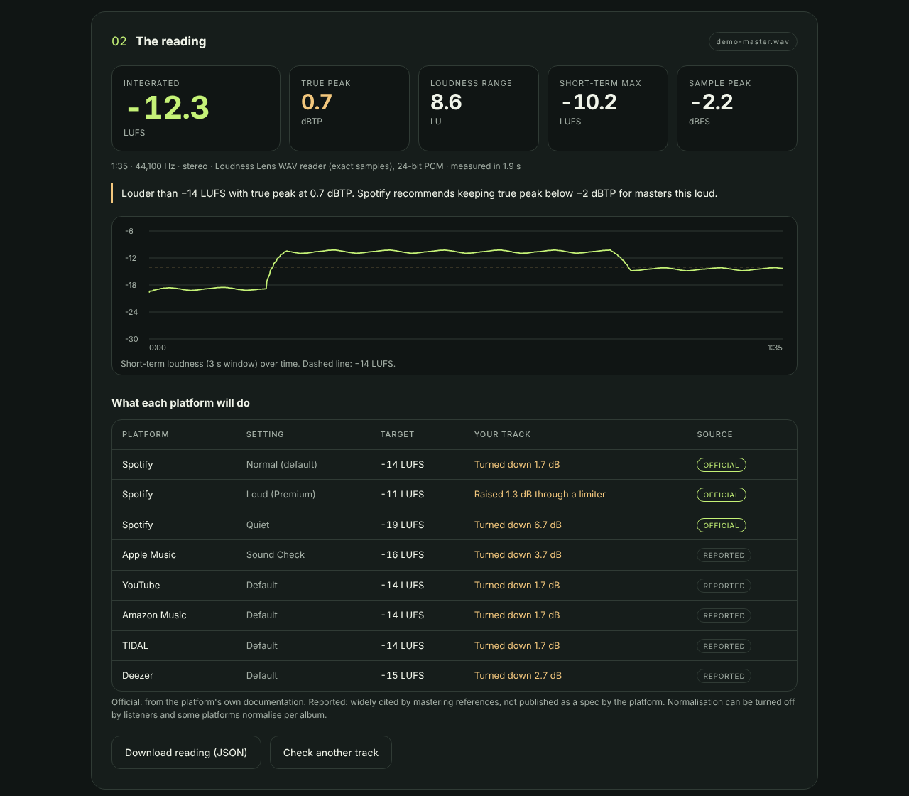

# Loudness Lens

**Check your master. Before the platforms do.**

Drop a track into your browser and get integrated loudness, true peak and loudness range, measured to ITU-R BS.1770 and EBU R128, plus what Spotify, Apple Music, YouTube and others will do to it. Your audio never leaves the tab.

**[Live demo](https://shelbygrayman.github.io/loudness-lens/)** · [Accuracy and benchmarks](BENCHMARKS.md) · [Report an issue](https://github.com/shelbygrayman/loudness-lens/issues)

*Screenshot: a synthetic test track, not a real release. Note the sample peak at −2.2 dBFS hiding a true peak above 0 dBTP.*

## Why

I write music. Before a release I want three numbers I can trust and a plain answer to "will Spotify turn this down, and will it clip on the way?". Most meters that answer that are paid plugins or upload your file. This one is a single static page.

## What you get

- **Integrated loudness** (LUFS) with BS.1770-4 gating, plus momentary and short-term maxima.
- **True peak** (dBTP) with 8x oversampling, and sample peak for comparison.
- **Loudness range** (LU) per EBU Tech 3342.
- **A short-term loudness curve** across the whole track.
- **A platform table**: how much each service turns the track down, or whether it may raise it. Spotify's targets come from Spotify's own documentation and are marked *Official*; the others are widely reported and marked *Reported*.
- **Spotify's true-peak advice** applied to your numbers: below −1 dBTP, or below −2 dBTP if the master is louder than −14 LUFS.
- A JSON download of the reading.

## Run it

1. Open the [demo](https://shelbygrayman.github.io/loudness-lens/), or serve this folder: `python3 -m http.server`.
2. Drop a WAV for exact results, or any format your browser can decode.
3. Read the numbers and the limits below.

## Accuracy

`npm test` runs 22 tests: the BS.1770 coefficient table, the EBU Tech 3341 and 3342 test cases, intersample peaks, the WAV reader and the platform maths. `npm run compare` measures the same signals with ffmpeg's `ebur128` and with a much finer true-peak reference. Integrated loudness and loudness range match ffmpeg to 0.1 LU on every case. Details and raw results are in [BENCHMARKS.md](BENCHMARKS.md).

## Important boundaries

- True peak is an estimate. On the benchmark it reads within 0.1 dB of the reference, or up to 0.4 dB high on heavily clipped audio.
- Non-WAV files are decoded by your browser and resampled to 48 kHz.
- Platform behaviour changes, listeners can switch normalisation off, and some platforms normalise per album. The table is a guide.
- Mono is measured as one channel, as BS.1770 specifies. Tools that treat mono as dual mono read about 3 LU louder.
- Six-channel files are treated as 5.1 in WAV order (L R C LFE Ls Rs: LFE excluded, surrounds +1.5 dB). Other channel counts weight every channel equally.

## License

MIT
